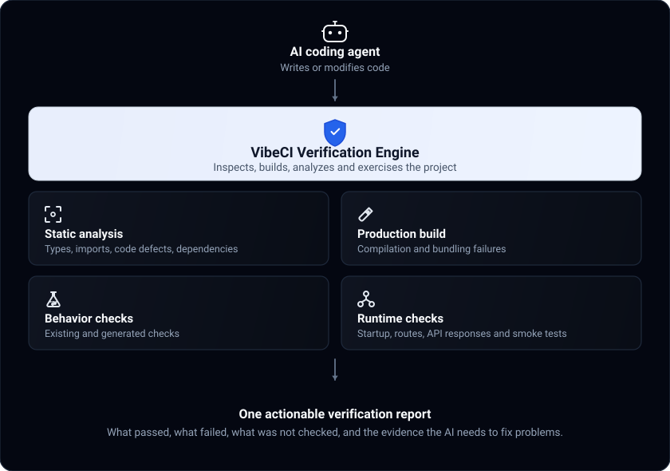
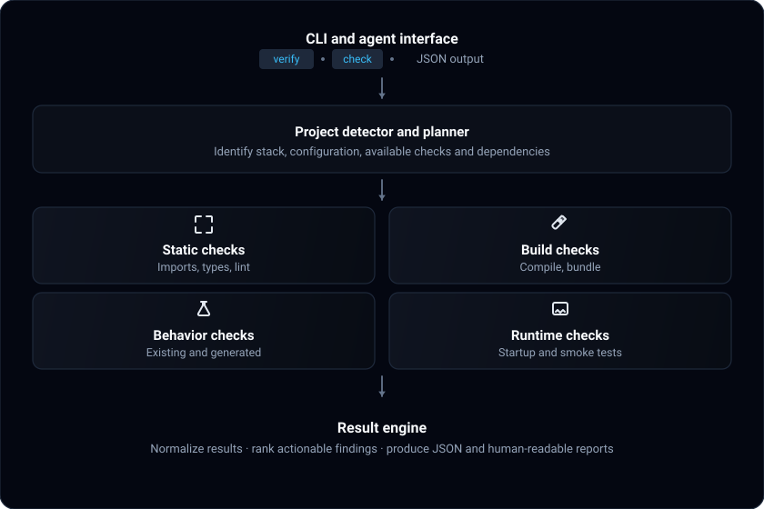

# VibeCI Architecture & Technical Specification ⚡

> **Local Software Verification Engine for AI-Generated Code**

---

## 1. System Overview

Traditional developer tooling separates testing into isolated silos: linters (`eslint`, `ruff`), typecheckers (`tsc`, `mypy`), build systems (`vite`, `webpack`, `turbo`), and test runners (`jest`, `vitest`, `pytest`). When developers build with AI coding agents, they frequently write little to no tests, making standard test runners ineffective.

VibeCI unifies these layers into a **single, local software verification engine** that detects defects before code reaches remote CI or production—even when zero unit tests exist.

  

### Pipeline Architecture

  

---

## 2. Core Verification Layers

### Layer 1: Static Health & Preflight (Zero Tests Required)
- **Environment Preflight (`EnvAuditor`)**:
  - Scans project source files (`.js`, `.jsx`, `.ts`, `.tsx`, `.py`) for references to `process.env.VAR` and `os.environ["VAR"]`.
  - Audits referenced variables against `.env.example`, `.env`, and `.env.local`.
  - Flags undocumented environment variables that would cause runtime crashes in remote environments or CI pipelines.
- **Secret Leak Scanner (`SecretScanner`)**:
  - Performs high-performance regex scanning against cryptographic keys, AWS tokens, GitHub PATs, and database connection strings with passwords.
  - Automatically ignores sample strings and test fixtures.
- **Static Type & Lint Analyzers**:
  - Automatically identifies and invokes configured project tools (`tsc --noEmit`, `mypy`, `ruff`, `eslint`, `biome`).

### Layer 2: Production Build Verification (`BuildVerifier`)
- Automatically discovers production bundling scripts (`npm run build`, `turbo build`, `uv build`).
- Executes compilation within isolated subprocess sessions.
- Differentiates non-fatal warnings from hard compilation crashes.
- Catches missing asset references, unresolvable module paths, and build configuration errors.

### Layer 3: Runtime Smoke Testing (`RuntimeSmokeTester`)
- Boots the application process in a sandboxed, non-interactive background process group (`start_new_session=True`).
- Watches for premature startup crashes (e.g. fatal unhandled exceptions during module initialization).
- Probes port readiness via socket listener checks.
- Issues HTTP GET requests against critical routes (`/`, `/api/health`).
- Validates that responses return HTTP status codes `< 500`.
- Issues clean shutdown (`SIGTERM` followed by `SIGKILL` to the process group) to ensure zero dangling port listeners.

### Layer 4: Behavior & Existing Unit Tests (`CheckRunner`)
- Detects and executes existing test suites (`pytest`, `vitest`, `jest`).
- Forces non-interactive CI mode (`CI=true`, `stdin=DEVNULL`) to prevent interactive watch-mode hanging.
- Extracts root-cause failure lines, stack traces, and `file:line:col` locations for machine and human consumption.

### Layer 5: Honest Accounting of Unverified Work
- Explicitly states what could **not** be verified (e.g. unconfigured databases, live payment APIs, end-to-end browser journeys).
- Prevents the false sense of security that passing unit tests guarantees production readiness.

---

## 3. Phase 3: Smart Change-Aware Verification (`--diff`)

When working with AI coding agents that modify small sets of files in rapid iterations, full-project verification can be slow. 

The `GitChangeAnalyzer` optimizes verification:
1. Queries `git status --porcelain` and `git diff` to identify modified and untracked files.
2. Directs `SecretScanner` and `EnvAuditor` to inspect **only the modified files**.
3. Maps modified code files to adjacent test files (e.g. `Component.jsx` -> `Component.test.jsx`).
4. In monorepos (e.g., Turborepo), scopes linting and testing to the affected packages.
5. **Fast Clean Exit:** If the working tree is clean, returns in **< 50 milliseconds**.

---

## 4. Privacy & Security Model

- **100% Local Execution:** VibeCI makes zero outbound network requests. No source code, error logs, or environment names ever leave your machine.
- **No Secret Persistence:** Secret detection results only report the file and line number; sensitive credentials are never stored in reports or written to disk.
- **Process Group Isolation:** Every external command runs in its own process group with strict timeouts, preventing infinite loops or orphaned worker processes.
